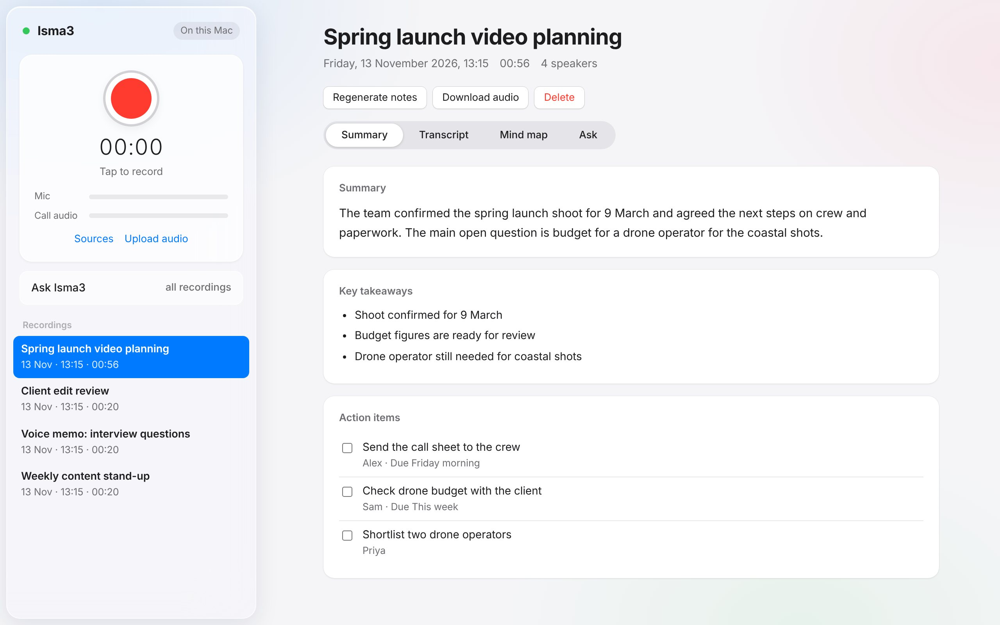

# Isma3

**Every conversation, captured. Nothing leaves your Mac.**

Isma3 records your meetings and calls, then gives you:
- a transcript with speaker names
- a summary
- action items
- a mind map

You can also ask questions across all your recordings. Everything runs on your Mac: there's no account, cloud or subscription.

**[Landing page →](https://salah896-netizen.github.io/isma3/)** · **[User Guide →](https://salah896-netizen.github.io/isma3/guide.html)**



## Install (about 30 minutes, mostly downloads)

You need a Mac with Apple Silicon (M1 or newer), 16 GB of memory and about 15 GB of free space.

1. Open **Terminal** (press ⌘ Space, type "Terminal" and press Return), paste this line and press Return:
   ```bash
   curl -fsSL https://raw.githubusercontent.com/salah896-netizen/isma3/main/get.sh | bash
   ```
   This downloads Isma3 into `~/Isma3` and opens the installer.
2. The installer sets up these parts:
   - **Homebrew**, if you don't have it
   - **ffmpeg** and **Python**
   - **BlackHole**, for capturing call audio
   - **Ollama**, plus the AI models

   It asks for your name, an optional Obsidian vault and your Mac password.
3. When it says **All done**, open **Isma3** from Spotlight (⌘ Space, then type "Isma3"). Drag it to your Dock to keep it there. It opens in its own window.

To update, run the same Terminal line again. Your recordings, settings and models are kept.

## Recording calls (one-time)

1. Open **Audio MIDI Setup**, click **+**, then choose **Create Multi-Output Device**.
2. Tick your **headphones or speakers** first, then **BlackHole 2ch**. Turn on **Drift Correction** for BlackHole and rename the device **Isma3 Calls**.
3. Before a call, set **System Settings → Sound → Output** to **Isma3 Calls**. In Isma3, open **Sources** and set **Call audio** to **BlackHole 2ch**.

Per app:
- **Zoom**: Settings → Audio → Speaker: *Same as System*.
- **Microsoft Teams**: Settings → Devices → Speaker: *Isma3 Calls*.
- **WhatsApp**: use the Mac app or WhatsApp Web. Calls on your iPhone can't be captured.
- **FaceTime and iPhone calls answered on the Mac**: captured too.

Wear headphones if you can, so voices aren't recorded twice. Volume keys don't work on a Multi-Output device, so set the volume in the call app.

## Using it
- **Record**: click the red button (or press ⌥ Space). Processing starts as soon as you stop.
- **Upload audio**: works with voice memos and any audio or video file.
- **Rename speakers**: do it in the Transcript tab, then press **Regenerate notes** so the summary uses the real names.
- **Ask Isma3**: searches every recording, and each answer links to the moment it came from.

## Camera timecode and Premiere Pro
- **Upload files** accepts camera clips (MOV, MP4, MXF) and sound-recorder WAVs. Isma3 reads their timecode and frame rate, keeps only the audio, and stamps every transcript line with camera timecode.
- **Timecode** lets you set or correct the start timecode and frame rate by hand. Drop-frame is supported: `01:00:00;00`.
- **Export** offers three files:
  - SRT captions for Premiere (they line up with a sequence made from the clip)
  - a CSV select list (TC in, TC out, speaker, text)
  - a timecoded transcript

## Settings (`config.json`)
| Key | What it does |
|---|---|
| `name` | Your name, used in the greeting |
| `obsidian_vault`, `obsidian_folder` | Where to save a note for each recording. Leave the vault empty to switch this off |
| `llm_model` | `qwen3:14b` is the default. `qwen3:8b` is faster, and bigger models are better but slower. Run `ollama pull <name>` first |
| `language` | `null` auto-detects the language, or set it, e.g. `"en"` |
| `speaker_threshold` | Raise it if one person is split into two speakers, and lower it if two people are merged |

Restart Isma3 after changing settings.

## How it works
| Step | Tool |
|---|---|
| Transcription | Whisper large-v3-turbo via [mlx-whisper](https://github.com/ml-explore/mlx-examples) |
| Speaker labels | pyannote segmentation + TitaNet embeddings via [sherpa-onnx](https://github.com/k2-fsa/sherpa-onnx) |
| Summary, actions, mind map, Ask | Qwen3 via [Ollama](https://ollama.com) |
| Search | nomic-embed-text via Ollama |

Recordings live in `~/Isma3/data/recordings/`, one folder each.

## Troubleshooting
- **"Couldn't reach Ollama"**: open the Ollama app, then press **Retry**.
- **The mic level bar doesn't move**: go to System Settings → Privacy & Security → Microphone and allow your browser.
- **The call audio bar doesn't move**: check the output is set to *Isma3 Calls*.

Always tell people when you're recording. Recording without consent is illegal in many places.

MIT licence.
